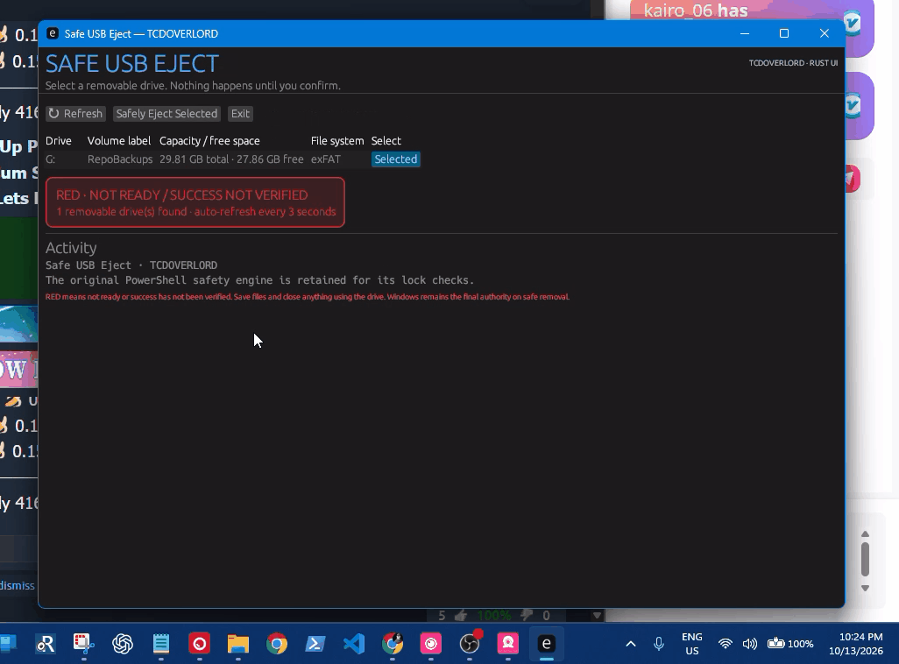

# Safe USB Eject by TCDOVERLORD

A Windows utility designed to help you safely remove USB drives through a guided, easy-to-follow workflow.

<p align="center">
  <a href="https://tcdoverlord.github.io/Windows-USB-Safe-Eject/">
    <strong>Visit the Safe USB Eject Website</strong>
  </a>
</p>

---

## Features

- **USB Drive Selection** — Choose the USB drive you want to remove.
- **Guided Removal** — Follow the application's safe-removal workflow.
- **Removal Detection** — Detect when the selected USB drive has been disconnected.
- **Status Feedback** — Follow the application's progress and completion status.
- **Windows Application** — Includes a graphical interface and a companion PowerShell script.

## Download and Run

You can download the project directly from GitHub.

1. Open the [Safe USB Eject repository](https://github.com/tcdoverlord/Windows-USB-Safe-Eject).
2. Click the green **Code** button.
3. Select **Download ZIP**.
4. Extract the downloaded ZIP file to a folder on your Windows computer.
5. Open the extracted project folder.
6. Open the `dist` folder.
7. Run `SafeUSB-Eject.exe`.

**Important:** Keep the application's files and folders together. The executable may depend on the companion PowerShell script located at:

`dist/scripts/Safe-USB-Eject.ps1`

Do not move the executable by itself or delete the companion script.

If the application does not start or Windows displays a security warning, do not bypass the warning automatically. Verify that the application came from the official repository before proceeding.

## How It Works

The intended workflow is:

1. Select the USB drive you want to remove.
2. Start the removal process.
3. Follow any Windows safe-removal prompts.
4. Disconnect the drive when it is safe to do so.
5. Allow the application to detect the removal and display its completion status.

**Always follow Windows' status messages.** If Windows reports that the drive is still in use, close any files or applications using it and resolve the issue before disconnecting it.

## Demonstration



## Safety Information

- Save your work before removing a USB drive.
- Close files and applications that may be using the drive.
- Never unplug a drive while data is being written to it.
- Do not force removal if Windows reports that the drive is still in use.
- If removal fails, resolve the problem before trying again.

Read the [Safety Documentation](docs/SAFETY.md) before using the application.

## Build from Source

To build the application yourself, you will need a compatible Windows environment, Rust and Cargo, and PowerShell.

1. Install Rust using the official [Rust installation instructions](https://www.rust-lang.org/tools/install).
2. Clone the repository:

   ```powershell
   git clone https://github.com/tcdoverlord/Windows-USB-Safe-Eject.git
   cd Windows-USB-Safe-Eject
   ```

3. Run the build script:

   ```powershell
   .\BUILD-EXE.bat
   ```

Review the build script and project documentation if you need to understand the build process or troubleshoot an error.

## Project Documentation

- [Safety Documentation](docs/SAFETY.md)
- [Test Checklist](TEST-CHECKLIST.md)
- [Changelog](CHANGELOG.md)
- [Rust Migration Notes](README-RUST-MIGRATION.md)

## Report a Problem

Found a bug or have a suggestion?

[Open an issue on GitHub](https://github.com/tcdoverlord/Windows-USB-Safe-Eject/issues).

When reporting a problem, include your Windows version, the steps you followed, and any error messages you received. Do not include sensitive personal information.

## License

Review the repository's [`LICENSE`](LICENSE) file for the terms governing use and redistribution.

**Note for maintainers:** Ensure the license metadata in `Cargo.toml` matches the actual license terms before distributing the project.

---

Created and maintained by [TCDOVERLORD](https://github.com/tcdoverlord).

[Visit the official project website](https://tcdoverlord.github.io/Windows-USB-Safe-Eject/).
